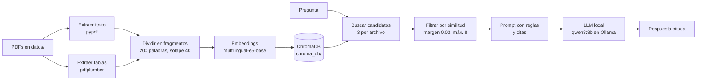

# NeuroClerk

NeuroClerk es un asistente para psiquiatría que responde consultas sobre interacciones farmacológicas y, en una próxima versión, ayudará a estructurar notas de evolución. Usa RAG: responde solo con la información de documentos de referencia, como el DSM-5 o fichas técnicas, y cita el archivo y la página de cada dato, para que cualquier respuesta se pueda verificar en la fuente. Funciona por completo en equipos propios, sin enviar información a servicios de terceros.

El estado de cada fase y los próximos pasos están en [HOJA_DE_RUTA.md](HOJA_DE_RUTA.md).

Qué documentos poner en la carpeta `datos` y dónde conseguirlos: [DATOS.md](DATOS.md).

> **Aviso:** es una herramienta de apoyo y un proyecto en desarrollo. No reemplaza el juicio clínico ni la consulta de las fuentes originales.

## Cómo funciona



1. **Cargar:** lee el texto de cada página con `pypdf` y une las palabras cortadas con guion ("dificul- tad" → "dificultad").
2. **Tablas:** `pdfplumber` detecta las tablas y guarda cada una como un fragmento propio, con su título delante.
3. **Dividir:** parte el texto en fragmentos de 200 palabras que se solapan 40, para no cortar una idea a la mitad.
4. **Indexar:** convierte cada fragmento en un vector y lo guarda en ChromaDB. Solo se hace la primera vez, o cuando un PDF es nuevo o cambió.
5. **Recuperar:** busca los 3 fragmentos más parecidos de **cada** archivo y descarta los que quedan muy por debajo del mejor.
6. **Generar:** le pasa esos fragmentos al modelo con instrucciones de responder solo con el contexto y citar cada afirmación. La respuesta llega de a poco (streaming) y tiene un tope de 700 tokens.

## Estructura del proyecto

```text
NeuroClerk/
├── .venv/                 # entorno virtual (no se sube a Git)
├── datos/                 # tus PDFs (no se suben a Git)
├── chroma_db/             # vectores guardados (no se sube a Git)
├── rag.py                 # el programa completo
├── probar_tablas.py       # pruebas automáticas de la extracción de tablas
├── requirements.txt       # librerías principales
├── requirements-lock.txt  # versiones exactas de todo el entorno
├── .gitignore
├── HOJA_DE_RUTA.md
└── README.md
```

## Requisitos

- Windows 10/11 (también funciona en macOS y Linux cambiando los comandos de activación).
- **Python 3.12.** Las versiones más nuevas pueden no tener todavía PyTorch disponible.
- [Ollama](https://ollama.com) instalado y abierto.
- Unos 16 GB de RAM para `qwen3:8b`. Con 8 GB, usa `gemma3:4b`.
- VS Code con la extensión Python (opcional, pero recomendado).

## Instalación

```powershell
# 1. Crear y activar el entorno virtual con Python 3.12
py -3.12 -m venv .venv
.venv\Scripts\activate

# 2. Instalar las versiones exactas que funcionan (torch CPU incluido)
python -m pip install --upgrade pip setuptools wheel
pip install -r requirements-lock.txt

# 3. Descargar el modelo de lenguaje
ollama pull qwen3:8b
```

Si `requirements-lock.txt` falla, instala desde las librerías principales:

```powershell
pip install torch --index-url https://download.pytorch.org/whl/cpu
pip install -r requirements.txt
```

La primera vez, comenta la línea `os.environ["HF_HUB_OFFLINE"] = "1"` al principio de `rag.py` para que pueda descargar el modelo de embeddings. Después vuelve a activarla.

En VS Code: `Ctrl+Shift+P` → **Python: Select Interpreter** → el que dice `.venv`.

### Mantener las dependencias

- `requirements.txt` tiene solo las librerías principales; `requirements-lock.txt`, las versiones exactas de todo el entorno.
- **Cada vez que instales una librería nueva**, regenera el lock en ese momento:

  ```powershell
  pip freeze > requirements-lock.txt
  ```

- `pip freeze` no escribe la dirección de PyTorch CPU. Después de regenerarlo, agrega esta línea **al principio** del archivo; si no, falla la instalación de `torch==...+cpu`:

  ```text
  --extra-index-url https://download.pytorch.org/whl/cpu
  ```

### Por qué PyTorch CPU

PyTorch solo calcula los embeddings, y gracias a ChromaDB eso pesa únicamente al indexar. La respuesta la genera Ollama, que usa la GPU por su cuenta. La versión CPU pesa ~200 MB frente a más de 2 GB, y no depende de tener una tarjeta NVIDIA. Con una GPU NVIDIA y reindexaciones frecuentes, conviene instalar la versión CUDA desde [pytorch.org](https://pytorch.org/get-started/locally/).

## Uso

1. Copia tus PDFs en la carpeta `datos/` con nombres claros (`FT_Litio.pdf`, no `FT_63845.pdf`), porque el modelo cita el nombre del archivo.
2. Ejecuta:

   ```powershell
   python .\rag.py
   ```

3. Escribe tus preguntas. Para terminar, escribe `salir`.

La primera ejecución tarda varios minutos porque indexa todo. Las siguientes arrancan en segundos.

Para cada pregunta, el programa muestra los fragmentos usados con su puntaje de similitud. Mientras el modelo escribe aparecen puntos, y al final la respuesta:

```text
Fragmentos usados:
  -> [0.909] InteraccionesFarmacoloigicas_pr.pdf, página 9: Tabla 1. Fármacos que pueden causar...
  -> [0.894] InteraccionesFarmacoloigicas_pr.pdf, página 9: de receptores), en los procesos...

Generando respuesta...
..........................................

Respuesta:
...
```

## Configuración

Todo se ajusta en el bloque 0 de `rag.py`:

| Variable | Valor actual | Para qué sirve |
| --- | --- | --- |
| `MODELO_LLM` | `qwen3:8b` | Modelo de Ollama que redacta la respuesta |
| `MODELO_EMBEDDINGS` | `intfloat/multilingual-e5-base` | Modelo que convierte texto en vectores |
| `TAM_CHUNK` | `200` | Palabras por fragmento |
| `SOLAPE` | `40` | Palabras repetidas entre fragmentos seguidos |
| `K_POR_ARCHIVO` | `3` | Candidatos que se buscan en cada PDF |
| `MARGEN` | `0.03` | Se descartan los fragmentos que quedan más de esto por debajo del mejor |
| `MAX_FRAGMENTOS` | `8` | Tope de fragmentos que llegan al modelo |
| `VERSION_TEXTO` | `2` | Súbela cada vez que cambies cómo se extrae o se divide el texto |

En `responder` se configura el modelo: `temperature: 0.1` para que se apegue al texto, `num_ctx: 8192` para que quepan todos los fragmentos y `num_predict: 700` como tope de la respuesta.

Si cambias `MODELO_EMBEDDINGS`, `TAM_CHUNK`, `SOLAPE` o `VERSION_TEXTO`, el programa crea una colección nueva y vuelve a indexar todo automáticamente. Para empezar de cero, borra la carpeta `chroma_db/`.

## Pruebas

`probar_tablas.py` comprueba con 7 preguntas que las tablas del libro de interacciones se encuentran y se usan:

```powershell
python .\probar_tablas.py          # solo la búsqueda: rápido, sin Ollama
python .\probar_tablas.py --llm    # además revisa la respuesta del modelo
```

- **Búsqueda:** si el fragmento de la tabla esperada aparece entre los fragmentos usados.
- **Respuesta:** si el modelo menciona datos que solo están en esa tabla.

Resultado actual:

| # | Pregunta | Tabla | Búsqueda | Respuesta |
| --- | --- | --- | --- | --- |
| 1 | Fármacos que causan síndrome neuroléptico maligno | Tabla 1, pág. 9 | ✅ 1.º (0.909) | ✅ |
| 2 | Fármacos que causan síndrome serotoninérgico | Tabla 2, pág. 10 | ✅ 1.º (0.906) | ✅ |
| 3 | Fármacos que prolongan el QT | Tabla 3, pág. 11 | ✅ 4.º (0.881) | ✅ |
| 4 | IECA y litio | Tabla 5, pág. 177 | ❌ | ✅* |
| 5 | Isoenzimas que metabolizan la clozapina | Tabla 7, pág. 265 | ❌ | ✅* |
| 6 | Metabolismo del alprazolam | Tabla 9, pág. 268 | ✅ 1.º (0.869) | ✅ |
| 7 | Inhibidores del CYP2D6 | Tabla 6, pág. 20 | ❌ | ✅* |

\* La respuesta es correcta, pero el dato salió de otros fragmentos (fichas técnicas o texto del capítulo), no de la tabla. Las palabras clave de estos casos son demasiado fáciles de encontrar en otras fuentes y hay que ajustarlas.

Las tablas que fallan son largas y con columnas: se parten en trozos que mezclan varias filas, o sus columnas se juntan en una sola lista.

Después de cada cambio en la extracción o la búsqueda, vuelve a correr las pruebas y compara.

## 📚 Documentos de prueba

Los PDFs no se incluyen en el repositorio por su tamaño y por derechos de autor. Cada persona debe conseguirlos y copiarlos en la carpeta `datos/`.

| Archivo | Contenido | Páginas | Disponibilidad |
| --- | --- | --- | --- |
| `dsm5.pdf` | DSM-5, criterios diagnósticos (escaneado con OCR) | 1000 | Protegido por derechos de autor, no se puede compartir |
| `InteraccionesFarmacoloigicas_pr.pdf` | Introducción a las interacciones farmacológicas (SEFH) | 367 | Publicación de la SEFH |
| `FT_Sertralina.pdf`, `FT_Litio.pdf`, `FT_Quetiapina.pdf`, `FT_Clozapina.pdf` | Fichas técnicas de la AEMPS | 15–28 c/u | Públicas y gratuitas en CIMA |

### Cómo descargar las fichas técnicas de CIMA

Las fichas técnicas de la Agencia Española de Medicamentos (AEMPS) son públicas y se descargan gratis desde [CIMA](https://cima.aemps.es):

1. Entra en [cima.aemps.es](https://cima.aemps.es) y busca el principio activo (por ejemplo, *sertralina*).
2. Elige una presentación de la lista de resultados. Cualquiera sirve, porque la información clínica es casi igual entre laboratorios.
3. En la ficha del medicamento, abre el documento **Ficha técnica** en formato PDF y descárgalo.
4. Renómbralo con un nombre claro, por ejemplo `FT_Sertralina.pdf`. CIMA lo descarga con el número de registro (`FT_63845.pdf`), y el nombre del archivo es lo que aparece en las citas de cada respuesta.
5. Cópialo en `datos/` y vuelve a ejecutar `python .\rag.py`. Los archivos nuevos se indexan automáticamente.

### Sobre el DSM-5

El DSM-5 pertenece a la American Psychiatric Association y no se puede redistribuir. Si tienes un ejemplar en PDF con licencia propia, puedes añadirlo a `datos/` para tu uso personal. Si no, el proyecto funciona igual con las fichas técnicas y otros documentos públicos; solo no podrá responder preguntas sobre criterios diagnósticos.

> Si un PDF es escaneado y no tiene capa de texto, NeuroClerk todavía no puede leerlo (falta el OCR, ver *Limitaciones conocidas*).

### Problemas encontrados y cómo se resolvieron

### Calidad de la búsqueda

| Problema | Causa | Solución |
| --- | --- | --- |
| El DSM-5 acaparaba todos los resultados | Es casi tres veces más grande que el resto | Traer candidatos de cada archivo por separado |
| Se ignoraba el final de cada fragmento | `MiniLM-L12` lee solo ~128 tokens (~80 palabras) | Cambiar a `multilingual-e5-base` (~300 palabras), con los prefijos `passage:` y `query:` |
| Fragmentos sin relación con la pregunta | Siempre se traía la misma cantidad de cada archivo | Filtro por margen de similitud respecto al mejor |
| Nombrar la fuente en la pregunta empeoraba la búsqueda | "según el DSM-5" atraía páginas que repiten "DSM-5" | Preguntar sin nombrar las fuentes |
| Palabras cortadas ("tem- poral") | OCR del DSM-5 | Expresión regular que une las palabras al cargar |
| Las tablas nunca se encontraban | pypdf las aplana en una lista de nombres sin título, partida en varios fragmentos | Extraerlas con `pdfplumber` como fragmentos propios con el título delante |
| Las tablas largas con columnas todavía no se encuentran | Se parten en trozos que mezclan filas, o se pierden las columnas | Pendiente: un fragmento por fila (ver la hoja de ruta) |

### Calidad de la respuesta

| Problema | Causa | Solución |
| --- | --- | --- |
| `llama3.2` fallaba la mayoría de las preguntas | Modelo de 3B, débil en español | Cambiar a `qwen3:8b` |
| Respuestas lentas con texto en inglés antes de `</think>` | `qwen3:4b` es la variante que siempre razona | Usar `qwen3:8b` con `think=False` y recortar lo anterior a `</think>` |
| Datos inventados o mezclados (por ejemplo, "hiperkinesia") | Prompt poco estricto y temperatura por defecto | Reglas explícitas, cita después de cada afirmación y `temperature=0.1` |
| Usaba una sola fuente aunque recibía varias | El modelo copiaba el fragmento más fácil | Regla "si varios fragmentos aportan datos distintos, inclúyelos todos" |
| Parecía colgado en algunas preguntas | Copiaba listas de más de 100 fármacos y no mostraba nada hasta terminar | `stream=True` con un punto por trozo y tope de `num_predict: 700` |
| Recalcular los embeddings en cada ejecución | Los vectores vivían solo en memoria | ChromaDB guardado en disco |

## Resultados de las pruebas

Pregunta de referencia: *"¿Qué es el síndrome neuroléptico maligno, cuáles son sus síntomas y qué fármacos pueden causarlo?"*

| Etapa | Búsqueda | Respuesta |
| --- | --- | --- |
| `llama3.2` + MiniLM | No encontraba la descripción del DSM-5 | La mayoría de las preguntas, mal |
| `qwen3:8b` + e5 | Encontraba DSM-5 págs. 759–760 | 5 errores (síntomas invertidos, fármacos mal clasificados) |
| + prompt con citas y temperatura baja | Igual | 1 error (mezclaba dos síndromes) |
| + filtro por similitud | 6–7 fragmentos, todos relevantes | Sin errores, pero sin usar el DSM-5 |
| + regla "inclúyelos todos" | Igual | Combina 3 fuentes; 1 cita con la página equivocada |
| + tablas con pdfplumber | La Tabla 1 aparece primera (0.909) | Incluye fármacos que solo están en la tabla (amantadina, tolcapona, metilfenidato) |

## Limitaciones conocidas

- **Modelo chico:** un modelo de 8B a veces mezcla conceptos parecidos o cita la página equivocada. Siempre hay que revisar las fuentes.
- **Tablas con columnas:** la extracción actual junta las columnas de algunas tablas (por ejemplo, *Sustratos* e *Inhibidores*) y se pierde qué dato es cuál.
- **Respuestas largas:** con el tope de 700 tokens, una lista muy larga puede quedar cortada.
- **PDFs escaneados sin texto:** si `extract_text()` devuelve vacío, hace falta OCR, que todavía no está implementado.
- **Números de página:** son los del PDF, no los impresos en el libro.
- **Preguntas comparativas** ("¿cuáles de estos cuatro fármacos...?") son difíciles para un RAG simple, porque la búsqueda trae fragmentos parecidos a la pregunta y no necesariamente el dato de cada documento.
