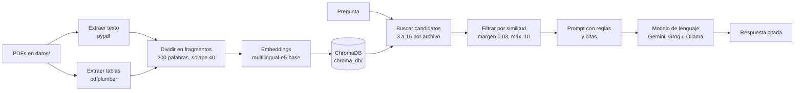

# NeuroClerk

NeuroClerk es un asistente para psiquiatría que responde consultas sobre interacciones farmacológicas y, en una próxima versión, ayudará a estructurar notas de evolución. Usa RAG: responde solo con la información de documentos de referencia, como el DSM-5 o fichas técnicas, y cita el archivo y la página de cada dato, para que cualquier respuesta se pueda verificar en la fuente. La búsqueda funciona siempre en equipos propios; la respuesta la puede redactar un modelo local o uno gratuito en la nube.

El estado de cada fase y los próximos pasos están en [HOJA_DE_RUTA.md](HOJA_DE_RUTA.md). 

Qué documentos usar y dónde conseguirlos, en [DATOS.md](DATOS.md).

> **Aviso:** es una herramienta de apoyo y un proyecto en desarrollo. No reemplaza el juicio clínico ni la consulta de las fuentes originales.

## Cómo funciona



1. **Cargar:** lee el texto de cada página con `pypdf` y une las palabras cortadas con guion ("dificul- tad" → "dificultad").
2. **Tablas:** `pdfplumber` detecta las tablas y las guarda con su título delante: un fragmento por fila en las tablas con columnas, y uno por categoría (por ejemplo *Sustratos* e *Inhibidores*) en las listas agrupadas. Las tablas que siguen en otra columna de la página heredan el título.
3. **Dividir:** parte el texto en fragmentos de 200 palabras que se solapan 40, para no cortar una idea a la mitad.
4. **Indexar:** convierte cada fragmento en un vector y lo guarda en ChromaDB. Solo se hace la primera vez, o cuando un PDF es nuevo o cambió. Cada PDF se reconoce por una huella de su contenido, así que la base se puede indexar en otra computadora (por ejemplo, en Colab).
5. **Recuperar:** busca los fragmentos más parecidos de **cada** archivo (3 en una ficha corta, hasta 15 en un libro) y descarta los que quedan muy por debajo del mejor.
6. **Generar:** le pasa esos fragmentos al modelo con instrucciones de responder solo con el contexto y citar cada afirmación. La respuesta llega de a poco (streaming), y los errores pasajeros del proveedor se reintentan solos.

## Estructura del proyecto

```
NeuroClerk/
├── .venv/                 # entorno virtual (no se sube a Git)
├── datos/                 # tus PDFs (no se suben a Git)
├── chroma_db/             # vectores guardados (no se sube a Git)
├── rag.py                 # el programa completo
├── probar_tablas.py       # pruebas automáticas de búsqueda y respuesta
├── descargar_fichas.py    # descarga las fichas técnicas de CIMA
├── revisar_datos.py       # revisa la carpeta datos/ antes de indexar
├── fuentes.csv            # registro de los documentos de datos/
├── DATOS.md               # qué documentos poner en datos/ y dónde conseguirlos
├── requirements.txt       # librerías principales
├── requirements-lock.txt  # versiones exactas de todo el entorno
├── .gitignore
├── HOJA_DE_RUTA.md
└── README.md
```

## Requisitos

- Windows 10/11 (también funciona en macOS y Linux cambiando los comandos de activación).
- **Python 3.12.** Las versiones más nuevas pueden no tener todavía PyTorch disponible.
- Una clave gratuita de Gemini o Groq, o bien [Ollama](https://ollama.com) instalado para usar un modelo local.
- Para el modelo local, unos 16 GB de RAM con `qwen3:8b` (con 8 GB, usa `gemma3:4b`).
- VS Code con la extensión Python (opcional, pero recomendado).

## Instalación

```powershell
# 1. Crear y activar el entorno virtual con Python 3.12
py -3.12 -m venv .venv
.venv\Scripts\activate

# 2. Instalar las versiones exactas que funcionan (torch CPU incluido)
python -m pip install --upgrade pip setuptools wheel
pip install -r requirements-lock.txt

# 3. Solo si vas a usar el modelo local
ollama pull qwen3:8b
```

Si `requirements-lock.txt` falla, instala desde las librerías principales:

```powershell
pip install torch --index-url https://download.pytorch.org/whl/cpu
pip install -r requirements.txt
```

La primera vez, el modelo de embeddings se tiene que descargar. Ejecuta con la variable `HF_HUB_OFFLINE=0`:

```powershell
$env:HF_HUB_OFFLINE = "0"; python .\rag.py
```

Las siguientes veces no hace falta: `rag.py` usa el modelo ya descargado sin conectarse a Hugging Face.

En VS Code: `Ctrl+Shift+P` → **Python: Select Interpreter** → el que dice `.venv`.

### Mantener las dependencias

- `requirements.txt` tiene solo las librerías principales; `requirements-lock.txt`, las versiones exactas de todo el entorno.
- **Cada vez que instales una librería nueva**, regenera el lock en ese momento:
  ```powershell
  pip freeze > requirements-lock.txt
  ```
- `pip freeze` no escribe la dirección de PyTorch CPU. Después de regenerarlo, agrega esta línea **al principio** del archivo; si no, falla la instalación de `torch==...+cpu`:
  ```
  --extra-index-url https://download.pytorch.org/whl/cpu
  ```

### Por qué PyTorch CPU

PyTorch solo calcula los embeddings, y gracias a ChromaDB eso pesa únicamente al indexar. La respuesta la genera el modelo de lenguaje, que no depende de PyTorch. La versión CPU pesa ~200 MB frente a más de 2 GB, y no depende de tener una tarjeta NVIDIA. Para indexar rápido, usa Colab (ver [Indexar en la nube](#indexar-en-la-nube-colab)).

## Modelo de lenguaje: local o en la nube

En el bloque 0 de `rag.py`, `PROVEEDOR` elige quién redacta la respuesta:

| `PROVEEDOR` | Modelo | Costo | Velocidad | A tener en cuenta |
| --- | --- | --- | --- | --- |
| `"gemini"` (por defecto) | `gemini-3.8-flash` | Plan gratuito | Rápido | Límite de peticiones por día; en el plan gratuito, Google puede usar lo enviado para mejorar sus productos |
| `"groq"` | `openai/gpt-oss-120b` | Plan gratuito | Muy rápido | Límite de 8.000 tokens por minuto: alcanza para 1 o 2 preguntas por minuto |
| `"ollama"` | `qwen3:8b` | Gratis | Lento en CPU | Nada sale de la computadora |

Los proveedores en la nube solo reciben la pregunta y los fragmentos encontrados, nunca los PDFs completos. Aun así, **no los uses con datos de pacientes**: para eso está `"ollama"`.

En el plan gratuito de Gemini, cada modelo tiene su propio límite diario. Si se agota, cambia el modelo en `MODELOS`, por ejemplo a `"gemini-3.5-flash-lite"`, o espera al día siguiente.

### Configurar la clave

1. Crea una clave gratuita:
   - Gemini: [aistudio.google.com/apikey](https://aistudio.google.com/apikey)
   - Groq: [console.groq.com/keys](https://console.groq.com/keys)
2. Guárdala como variable de entorno (no dentro de `rag.py`, para que no termine en Git):
   ```powershell
   setx GEMINI_API_KEY "tu_clave"
   setx GROQ_API_KEY "tu_clave"
   ```
3. Cierra **todas** las ventanas de VS Code y vuelve a abrirlo. Comprueba con `echo $env:GEMINI_API_KEY`.

Nunca pegues la clave completa en un chat, un archivo del proyecto ni un commit. Si eso pasa, bórrala en la consola del proveedor y crea otra.

Si falta la clave, el programa avisa al arrancar. Si se alcanza el límite gratuito, la respuesta lo dice. Los errores pasajeros (servidor saturado, código 503) se reintentan hasta 3 veces. Los límites actuales se ven en [AI Studio](https://aistudio.google.com/rate-limit) y en la [consola de Groq](https://console.groq.com/settings/limits).

## Uso

1. Pon tus PDFs en `datos/`. Las fichas técnicas de [DATOS.md](DATOS.md) se descargan solas:
   ```powershell
   python .\descargar_fichas.py
   ```
2. Revisa la carpeta antes de indexar:
   ```powershell
   python .\revisar_datos.py
   ```
   Avisa de PDFs escaneados sin texto, archivos que faltan en `fuentes.csv`, nombres poco claros y posibles duplicados.
3. Ejecuta:
   ```powershell
   python .\rag.py
   ```
4. Escribe tus preguntas. Para terminar, escribe `salir`.

**Nombres de archivo:** usa nombres claros y **sin tildes ni eñes** (`Guia_mhGAP.pdf`, no `Guía_mhGAP-spa.pdf`). El modelo cita el nombre del archivo, y las tildes se desconfiguran al pasar los archivos entre Windows y Colab.

Para cada pregunta, el programa muestra los fragmentos usados con su puntaje de similitud. Mientras el modelo escribe aparecen puntos, y al final la respuesta:

```
Fragmentos usados:
  -> [0.909] Interacciones_Farmacologicas_SEFH.pdf, página 9: Tabla 1. Fármacos que pueden causar...
  -> [0.894] Interacciones_Farmacologicas_SEFH.pdf, página 9: de receptores), en los procesos...

Generando respuesta...
..........................................

Respuesta:
...
```

## Indexar en la nube (Colab)

Indexar los ~3.200 páginas en una computadora sin GPU tarda mucho. En Google Colab, con una GPU gratuita, es mucho más rápido.

1. En tu PC, comprime lo necesario:
   ```powershell
   Compress-Archive -Path rag.py, datos -DestinationPath NeuroClerk.zip -Force
   ```
2. En [Colab](https://colab.research.google.com), crea un cuaderno, elige **Entorno de ejecución → Cambiar tipo de entorno → GPU T4** y sube `NeuroClerk.zip`.
3. Ejecuta estas tres celdas:
   ```python
   !unzip -q -o NeuroClerk.zip -d /content/NeuroClerk
   %cd /content/NeuroClerk
   !pip install -q pdfplumber==0.11.10 chromadb==1.5.9 "cryptography>=50.0,<51" pypdf
   ```
   ```python
   !HF_HUB_OFFLINE=0 SOLO_INDEXAR=1 python rag.py
   ```
   ```python
   !zip -qr chroma_db.zip chroma_db
   from google.colab import files
   files.download("chroma_db.zip")
   ```
4. En tu PC, borra la carpeta `chroma_db` vieja y descomprime `chroma_db.zip` en la raíz del proyecto. Al ejecutar `rag.py` deberías ver *"Ya indexado"* en todos los PDFs.

El aviso de conflictos de dependencias que muestra `pip` en Colab se puede ignorar. El `rag.py` de tu PC tiene que ser el mismo que usaste en Colab.

## Configuración

Todo se ajusta en el bloque 0 de `rag.py`:

| Variable | Valor actual | Para qué sirve |
| --- | --- | --- |
| `PROVEEDOR` | `"gemini"` | Quién redacta la respuesta: `"gemini"`, `"groq"` u `"ollama"` |
| `MODELOS` | ver `rag.py` | Qué modelo usa cada proveedor |
| `MODELO_EMBEDDINGS` | `intfloat/multilingual-e5-base` | Modelo que convierte texto en vectores |
| `TAM_CHUNK` | `200` | Palabras por fragmento |
| `SOLAPE` | `40` | Palabras repetidas entre fragmentos seguidos |
| `K_MIN`, `K_MAX` | `3`, `15` | Candidatos que se buscan en cada PDF: 3 en una ficha corta, hasta 15 en un libro |
| `FRAGMENTOS_POR_CANDIDATO` | `100` | Un candidato más por cada 100 fragmentos del documento |
| `MARGEN` | `0.03` | Se descartan los fragmentos que quedan más de esto por debajo del mejor |
| `MAX_FRAGMENTOS` | `10` | Tope de fragmentos que llegan al modelo |
| `VERSION_TEXTO` | `3` | Súbela cada vez que cambies cómo se extrae o se divide el texto |

El modelo trabaja con `temperature` 0.1, para que se apegue al texto. El tope de la respuesta es de 700 tokens con Ollama y de 2.000 con los proveedores en la nube, que cuentan su razonamiento dentro de ese tope.

Si cambias `MODELO_EMBEDDINGS`, `TAM_CHUNK`, `SOLAPE` o `VERSION_TEXTO`, el programa crea una colección nueva y vuelve a indexar todo automáticamente. Para empezar de cero, borra la carpeta `chroma_db/`.

Variables de entorno opcionales: `SOLO_INDEXAR=1` indexa y termina, sin pedir la clave del modelo; `HF_HUB_OFFLINE=0` permite descargar el modelo de embeddings.

## Pruebas

`probar_tablas.py` comprueba con 7 preguntas que la búsqueda encuentra las fuentes correctas y que el modelo las usa:

```powershell
python .\probar_tablas.py          # solo la búsqueda: rápido, no usa el modelo
python .\probar_tablas.py --llm    # además pide la respuesta al modelo (gasta 7 peticiones)
```

Para cada pregunta mide tres cosas:

- **Tabla:** si aparece la tabla del libro de interacciones que contiene la respuesta.
- **Fuente:** si aparece alguna fuente válida, sea la tabla o la ficha técnica del fármaco.
- **Respuesta:** si la respuesta nombra las palabras clave. En los casos 1, 2, 3 y 7 son fármacos que figuran **solo en la tabla** y en ninguna de las 51 fichas, así que nombrarlos prueba que el modelo usó la tabla.

Los avisos del proveedor (límite alcanzado, servidor caído) se cuentan como errores y no como fallos.

Resultado actual, con los 59 documentos y Gemini:

| # | Pregunta | Tabla | Puesto | Respuesta |
| --- | --- | --- | --- | --- |
| 1 | Fármacos que causan síndrome neuroléptico maligno | Tabla 1, pág. 9 | 1.º (0.909) | ✅ pergolida, tiopropenazina, tolcapona |
| 2 | Fármacos que causan síndrome serotoninérgico | Tabla 2, pág. 10 | 1.º (0.906) | ✅ dapoxetina, metiltionina, tapentadol |
| 3 | Fármacos que prolongan el QT | Tabla 3, pág. 11 | 5.º (0.881) | ✅ ebastina, retigabina, piperaquina, eribulina |
| 4 | IECA y litio | Tabla 5, pág. 177 | 1.º (0.888) | ✅ toxicidad, concentraciones |
| 5 | Isoenzimas que metabolizan la clozapina | Tabla 7, pág. 265 | 1.º (0.906) | ✅ CYP1A2 |
| 6 | Metabolismo del alprazolam | Tabla 9, pág. 268 | 2.º (0.885) | ✅ CYP3A4 |
| 7 | Inhibidores del CYP2D6 | Tabla 6, pág. 20 | 9.º (0.871) | ✅ imatinib, pazopanib, cinacalcet |

**Tabla 7/7 · Fuente 7/7 · Respuesta 7/7.**

Evolución:

| Versión | Tabla | Fuente | Respuesta |
| --- | --- | --- | --- |
| Tablas en bloques de 200 palabras, 3 candidatos por archivo | 4/7 | 6/7 | 6/7 |
| Tablas por filas y categorías, cupo proporcional al tamaño | **7/7** | **7/7** | **7/7** |

Después de cada cambio en la extracción o la búsqueda, vuelve a correr las pruebas y compara. Anota el resultado en el mensaje del commit.

## Documentos de prueba

59 PDFs, unas 3.200 páginas. El detalle de cada uno está en `fuentes.csv`, y cómo conseguirlos, en [DATOS.md](DATOS.md).

| Tipo | Documentos |
| --- | --- |
| Fichas técnicas | 51 psicofármacos y fármacos que interaccionan a menudo, descargados de [CIMA](https://cima.aemps.es) con `descargar_fichas.py` |
| Interacciones | *Introducción a las interacciones farmacológicas* (SEFH) y la tabla de enzimas CYP450 de Flockhart |
| Diagnóstico | DSM-5 y la guía de referencia de la CIE-11 (OMS) |
| Guías y formularios | Guía mhGAP (OMS/OPS) y Formulario Terapéutico de Medicamentos (MSP Uruguay) |
| Escalas | PHQ-9, GAD-7, YMRS y PANSS |

Los PDFs no se suben al repositorio por su tamaño y por derechos de autor.

## Problemas encontrados y cómo se resolvieron

### Instalación y entorno

| Problema | Causa | Solución |
| --- | --- | --- |
| "La ejecución de scripts está deshabilitada" | PowerShell bloquea `activate` | `Set-ExecutionPolicy -Scope CurrentUser RemoteSigned` |
| Muchos errores de dependencias | PyTorch todavía no estaba disponible para la versión más nueva de Python | Usar Python 3.12 e instalar PyTorch CPU primero |
| `No suitable Python runtime found` | Python 3.12 no estaba instalado | Instalarlo; puede convivir con otras versiones |
| `cryptography>=3.1 is required for AES` | El PDF de interacciones está cifrado | `pip install cryptography` |
| `NameError: name 'paso' is not defined` | Se borró una línea al editar | Usar el archivo completo en lugar de pegar trozos |
| `model 'qwen3:4b' not found` | El modelo no estaba descargado | `ollama pull <modelo>`; verificar con `ollama list` |
| Aviso "unauthenticated requests to the HF Hub" | Se consultaba Hugging Face en cada arranque | Modo offline con el modelo ya descargado |
| El entorno dejó de funcionar al renombrar la carpeta a `NeuroClerk` | En Windows, `.venv` guarda la ruta completa de la carpeta | Borrar `.venv`, recrearlo e instalar desde el lock; volver a elegir el intérprete en VS Code |
| `ModuleNotFoundError: No module named 'pdfplumber'` | El lock se generó antes de instalar pdfplumber | `pip install -r requirements.txt` y regenerar el lock |
| Los PDFs quedaron públicos en GitHub | Se subieron antes de agregar `datos/` al `.gitignore`, que no deja de seguir archivos ya subidos | Repositorio privado, `git filter-repo` para borrarlos del historial y repositorio nuevo para eliminar los commits huérfanos |
| Indexar tardaba horas | Embeddings en CPU sobre ~3.200 páginas | Indexar en Colab con GPU; huella por contenido para reutilizar la base en la PC |
| "Quitando Gu├нa_mhGAP-spa.pdf" al volver de Colab | La tilde se desconfiguró al comprimir en Windows y descomprimir en Linux | Nombres de archivo sin tildes ni eñes |

### Calidad de la búsqueda

| Problema | Causa | Solución |
| --- | --- | --- |
| El DSM-5 acaparaba todos los resultados | Es casi tres veces más grande que el resto | Traer candidatos de cada archivo por separado |
| Se ignoraba el final de cada fragmento | `MiniLM-L12` lee solo ~128 tokens (~80 palabras) | Cambiar a `multilingual-e5-base` (~300 palabras), con los prefijos `passage:` y `query:` |
| Fragmentos sin relación con la pregunta | Siempre se traía la misma cantidad de cada archivo | Filtro por margen de similitud respecto al mejor |
| Nombrar la fuente en la pregunta empeoraba la búsqueda | "según el DSM-5" atraía páginas que repiten "DSM-5" | Preguntar sin nombrar las fuentes |
| Palabras cortadas ("tem- poral") | OCR del DSM-5 | Expresión regular que une las palabras al cargar |
| Las tablas nunca se encontraban | pypdf las aplana en una lista de nombres sin título, partida en varios fragmentos | Extraerlas con `pdfplumber` como fragmentos propios con el título delante |
| Las tablas largas con columnas no se encontraban | Se partían en trozos que mezclaban filas, y se juntaban columnas como *Sustratos* e *Inhibidores* | Un fragmento por fila, uno por categoría, y título heredado en las continuaciones |
| Los libros grandes perdían frente a las fichas | Cada archivo aportaba 3 candidatos, tuviera 10 páginas o 367 | Cupo proporcional al tamaño: de 3 a 15 candidatos |

### Calidad de la respuesta

| Problema | Causa | Solución |
| --- | --- | --- |
| `llama3.2` fallaba la mayoría de las preguntas | Modelo de 3B, débil en español | Cambiar a `qwen3:8b` |
| Respuestas lentas con texto en inglés antes de `</think>` | `qwen3:4b` es la variante que siempre razona | Usar `qwen3:8b` con `think=False` y recortar lo anterior a `</think>` |
| Datos inventados o mezclados (por ejemplo, "hiperkinesia") | Prompt poco estricto y temperatura por defecto | Reglas explícitas, cita después de cada afirmación y `temperature=0.1` |
| Usaba una sola fuente aunque recibía varias | El modelo copiaba el fragmento más fácil | Regla "si varios fragmentos aportan datos distintos, inclúyelos todos" |
| Parecía colgado en algunas preguntas | Copiaba listas de más de 100 fármacos y no mostraba nada hasta terminar | Streaming con un punto por trozo y tope de tokens |
| Respuestas lentas con el modelo local | `qwen3:8b` en CPU | Modelo en la nube (Gemini o Groq) |
| `Error code: 503` | Servidores de Gemini saturados | Reintentos automáticos con espera de 2, 4 y 8 segundos |
| Se agotaba el límite diario de Gemini | El plan gratuito limita las peticiones por día | Cambiar de modelo o de proveedor; usar `probar_tablas.py` sin `--llm` cuando solo se revisa la búsqueda |
| Recalcular los embeddings en cada ejecución | Los vectores vivían solo en memoria | ChromaDB guardado en disco |

## Resultados de las pruebas

Pregunta de referencia: *"¿Qué es el síndrome neuroléptico maligno, cuáles son sus síntomas y qué fármacos pueden causarlo?"*

| Etapa | Búsqueda | Respuesta |
| --- | --- | --- |
| `llama3.2` + MiniLM | No encontraba la descripción del DSM-5 | La mayoría de las preguntas, mal |
| `qwen3:8b` + e5 | Encontraba DSM-5 págs. 759–760 | 5 errores (síntomas invertidos, fármacos mal clasificados) |
| + prompt con citas y temperatura baja | Igual | 1 error (mezclaba dos síndromes) |
| + filtro por similitud | 6–7 fragmentos, todos relevantes | Sin errores, pero sin usar el DSM-5 |
| + regla "inclúyelos todos" | Igual | Combina 3 fuentes; 1 cita con la página equivocada |
| + tablas con pdfplumber | La Tabla 1 aparece primera (0.909) | Incluye fármacos que solo están en la tabla |
| + 59 documentos y Gemini | Tabla 1 primera, más DSM-5 y fichas | Lista completa de la tabla, DSM-5 y una ficha, sin errores y en segundos |

## Limitaciones conocidas

- **Hay que revisar las fuentes:** aunque los resultados son buenos, el modelo puede citar una página equivocada o mezclar conceptos parecidos.
- **Una tabla puede ocupar muchos lugares:** con un fragmento por fila, varias filas de la misma tabla pueden llenar el contexto y dejar fuera otras fuentes.
- **Límites del plan gratuito:** los proveedores en la nube limitan las peticiones por día o por minuto.
- **PDFs escaneados sin texto:** si `extract_text()` devuelve vacío, hace falta OCR, que todavía no está implementado.
- **Números de página:** son los del PDF, no los impresos en el libro.
- **Preguntas comparativas** ("¿cuáles de estos cuatro fármacos...?") son difíciles para un RAG simple, porque la búsqueda trae fragmentos parecidos a la pregunta y no necesariamente el dato de cada documento.
