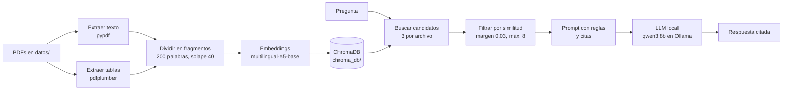

# NeuroClerk

## Propuesta de proyecto psiquiátrico (MVP)

NeuroClerk es un asistente local para documentación clínica y consultas farmacológicas basado en RAG. Su objetivo es ayudar a estructurar notas de evolución y responder preguntas sobre interacciones medicamentosas usando únicamente documentos locales, sin depender de servicios externos ni alucinaciones del modelo.

## ✨ Descripción general

- **Objetivo principal:** apoyar al psiquiatra a redactar una nota de evolución con foco en el Examen del Estado Mental.
- **Consulta segura:** responde preguntas farmacológicas consultando solo los PDFs o fuentes locales disponibles.
- **Privacidad:** todo se ejecuta localmente, incluyendo embeddings, vector store y modelo de lenguaje.
- **Tecnología sugerida:** Python + Ollama + ChromaDB + RAG + Streamlit.

## 🧭 Hoja de ruta

- [Hoja de ruta](./HOJA_DE_RUTA.md)

## 🏗️ Stack tecnológico

- **Lenguaje:** Python
- **Modelo local:** Ollama (por ejemplo `qwen3:8b` o `llama3` / `mistral`)
- **RAG / embeddings:** `sentence-transformers` y ChromaDB
- **Interfaz sugerida:** Streamlit
- **Privacidad:** no se usan APIs externas para la parte clínica

## 🔄 Cómo funciona



1. **Cargar:** lee el texto de cada página con `pypdf` y reune palabras cortadas con guion (por ejemplo, `dificul-tad` → `dificultad`).
2. **Tablas:** `pdfplumber` detecta tablas y las guarda como fragmentos propios con su título incluido.
3. **Dividir:** convierte el texto en fragmentos de 200 palabras con solape de 40.
4. **Indexar:** genera embeddings y los guarda en ChromaDB.
5. **Recuperar:** busca los 3 fragmentos más parecidos de cada archivo y descarta los que queden muy por debajo del mejor.
6. **Generar:** entrega esos fragmentos al modelo con instrucciones para responder solo con contexto y citar cada afirmación.

## 📁 Estructura del proyecto

```text
NeuroClerk/
├── .venv/                 # entorno virtual (no se sube a Git)
├── datos/                 # PDFs de referencia (no se suben a Git)
├── chroma_db/             # vectores y metadatos guardados
├── rag.py                 # lógica principal del proyecto
├── requirements.txt       # dependencias principales
├── requirements-lock.txt  # versiones exactas del entorno
├── .gitignore
├── Hoja de ruta.md        # plan del proyecto
├── README.md
└── ...
```

## ✅ Requisitos

- Windows 10/11 (también funciona en macOS/Linux con mínimos cambios).
- **Python 3.12**. Versiones más nuevas pueden no tener PyTorch disponible todavía.
- [Ollama](https://ollama.com) instalado y ejecutándose.
- 16 GB de RAM recomendados para `qwen3:8b`; con 8 GB puedes usar `gemma3:4b`.
- VS Code con la extensión Python (opcional, pero muy recomendado).

## ⚙️ Instalación

```powershell
# 1. Crear y activar el entorno virtual con Python 3.12
py -3.12 -m venv .venv
.venv\Scripts\activate

# 2. Instalar dependencias
python -m pip install --upgrade pip setuptools wheel
pip install -r requirements-lock.txt

# 3. Descargar el modelo local de lenguaje
ollama pull qwen3:8b
```

Si `requirements-lock.txt` falla, instala primero desde `requirements.txt`:

```powershell
pip install torch --index-url https://download.pytorch.org/whl/cpu
pip install -r requirements.txt
```

### Mantener las dependencias

- `requirements.txt` contiene las librerías principales.
- `requirements-lock.txt` conserva las versiones exactas del entorno.
- Cuando agregues nuevas librerías, genera el lock nuevamente:

```powershell
pip freeze > requirements-lock.txt
```

- `pip freeze` no incluye la URL de PyTorch CPU. Por eso, después de regenerar el archivo, agrega esta línea al principio:

```text
--extra-index-url https://download.pytorch.org/whl/cpu
```

### ¿Por qué PyTorch CPU?

PyTorch solo se usa para crear embeddings. La respuesta final la genera Ollama usando su propio runtime local. La versión CPU pesa menos que CUDA y evita depender de una GPU NVIDIA.

La primera vez, puede ser necesario comentar la línea `os.environ["HF_HUB_OFFLINE"] = "1"` al inicio de `rag.py` para que descargue el modelo de embeddings. Después puedes volver a activarla.

En VS Code: `Ctrl+Shift+P` → **Python: Select Interpreter** → seleccionar el intérprete `.venv`.

## ▶️ Uso

1. Copia tus PDFs en la carpeta `datos/` con nombres claros (`FT_Litio.pdf`, no `FT_63845.pdf`).
2. Ejecuta:

```powershell
python .\rag.py
```

3. Escribe tus preguntas. Para salir, escribe `salir`.

La primera ejecución puede tardar varios minutos porque indexa el contenido. Las siguientes se ejecutan mucho más rápido.

Ejemplo de salida:

```text
Fragmentos usados:
  -> [0.909] InteraccionesFarmacoloigicas_pr.pdf, página 9: Tabla 1. Fármacos que pueden causar...
  -> [0.894] InteraccionesFarmacoloigicas_pr.pdf, página 9: de receptores), en los procesos...

Respuesta:
...
```

## 🧪 Configuración

Todo se ajusta en el bloque 0 de `rag.py`:

| Variable | Valor actual | Para qué sirve |
| --- | --- | --- |
| `MODELO_LLM` | `qwen3:8b` | Modelo de Ollama que redacta la respuesta |
| `MODELO_EMBEDDINGS` | `intfloat/multilingual-e5-base` | Modelo de embeddings |
| `TAM_CHUNK` | `200` | Palabras por fragmento |
| `SOLAPE` | `40` | Solapamiento entre fragmentos |
| `K_POR_ARCHIVO` | `3` | Candidatos buscados por cada PDF |
| `MARGEN` | `0.03` | Umbral para filtrar fragmentos |
| `MAX_FRAGMENTOS` | `8` | Límite de fragmentos que llegan al modelo |
| `VERSION_TEXTO` | `2` | Versión del pipeline de extracción/división |

Si cambias `MODELO_EMBEDDINGS`, `TAM_CHUNK`, `SOLAPE` o `VERSION_TEXTO`, el programa crea una colección nueva y vuelve a indexar todo automáticamente. Para empezar de cero, borra la carpeta `chroma_db/`.

## 📚 Documentos de prueba

| Archivo | Contenido | Páginas |
| --- | --- | --- |
| `dsm5.pdf` | DSM-5, criterios diagnósticos (escaneado con OCR) | 1000 |
| `InteraccionesFarmacoloigicas_pr.pdf` | Introducción a las interacciones farmacológicas (SEFH) | 367 |
| `FT_Sertralina.pdf`, `FT_Litio.pdf`, `FT_Quetiapina.pdf`, `FT_Clozapina.pdf` | Fichas técnicas de la AEMPS ([CIMA](https://cima.aemps.es)) | 15–28 c/u |

Los PDFs no se suben al repositorio por su tamaño y derechos de autor.

## 🛠️ Problemas encontrados y soluciones

### Problemas de instalación

| Problema | Causa | Solución |
| --- | --- | --- |
| "La ejecución de scripts está deshabilitada" | PowerShell bloquea `activate` | `Set-ExecutionPolicy -Scope CurrentUser RemoteSigned` |
| Muchos errores de dependencias | PyTorch todavía no estaba disponible para la versión más nueva de Python | Usar Python 3.12 e instalar PyTorch CPU primero |
| `No suitable Python runtime found` | Python 3.12 no estaba instalado | Instalarlo; puede convivir con otras versiones |
| `cryptography>=3.1 is required for AES` | El PDF de interacciones está cifrado | `pip install cryptography` |
| `NameError: name 'paso' is not defined` | Se borró una línea al editar | Usar el archivo completo en lugar de pegar trozos |
| `model 'qwen3:4b' not found` | El modelo no estaba descargado | `ollama pull <modelo>`; verificar con `ollama list` |
| Aviso "unauthenticated requests to the HF Hub" | Se consultaba Hugging Face en cada arranque | `HF_HUB_OFFLINE=1` con el modelo ya descargado |
| El entorno dejó de funcionar al renombrar la carpeta a `NeuroClerk` | Windows guarda la ruta completa de la carpeta en `.venv` | Borrar `.venv`, recrearlo e instalar desde el lock |
| `ModuleNotFoundError: No module named 'pdfplumber'` | El lock se generó antes de instalar `pdfplumber` | `pip install -r requirements.txt` y regenerar el lock |

### Calidad de la búsqueda

| Problema | Causa | Solución |
| --- | --- | --- |
| El DSM-5 acaparaba todos los resultados | Era mucho más grande que el resto | Traer candidatos de cada archivo por separado |
| Se ignoraba el final de cada fragmento | `MiniLM-L12` lee solo ~128 tokens | Cambiar a `multilingual-e5-base` |
| Fragmentos sin relación con la pregunta | Se traía la misma cantidad de cada archivo | Filtro por margen de similitud respecto al mejor |
| Nombrar la fuente empeoraba la búsqueda | La pregunta repetía palabras muy comunes del texto fuente | Preguntar sin nombrar las fuentes |
| Palabras cortadas (`tem-poral`) | OCR del DSM-5 | Expresión regular para unir palabras al cargar |
| Las tablas nunca se encontraban | `pypdf` las aplana sin título claro | Extraerlas con `pdfplumber` como fragmentos propios |

### Calidad de la respuesta

| Problema | Causa | Solución |
| --- | --- | --- |
| `llama3.2` fallaba la mayoría de las preguntas | Modelo de 3B, débil en español | Cambiar a `qwen3:8b` |
| Respuestas lentas con texto en inglés antes de `</think>` | `qwen3:4b` razona por defecto | Usar `qwen3:8b` con `think=False` |
| Datos inventados o mezclados | Prompt poco estricto y temperatura por defecto | Reglas explícitas y `temperature=0.1` |
| Usaba una sola fuente aunque recibía varias | Copiaba el fragmento más fácil | Regla para incluir varias fuentes si aportan datos distintos |
| Recalcular embeddings en cada ejecución | Los vectores vivían solo en memoria | Guardar la base en ChromaDB |

## 📊 Resultados de las pruebas

Pregunta de referencia: *"¿Qué es el síndrome neuroléptico maligno, cuáles son sus síntomas y qué fármacos pueden causarlo?"*

| Etapa | Búsqueda | Respuesta |
| --- | --- | --- |
| `llama3.2` + MiniLM | No encontraba la descripción del DSM-5 | La mayoría de las preguntas, mal |
| `qwen3:8b` + e5 | Encontraba DSM-5 págs. 759–760 | 5 errores (síntomas invertidos, fármacos mal clasificados) |
| + prompt con citas y temperatura baja | Igual | 1 error (mezclaba dos síndromes) |
| + filtro por similitud | 6–7 fragmentos, todos relevantes | Sin errores, pero sin usar el DSM-5 |
| + regla "inclúyelos todos" | Igual | Combina 3 fuentes; 1 cita con la página equivocada |
| + tablas con pdfplumber | La Tabla 1 aparece primera (0.909) | Pendiente de probar |

## ⚠️ Limitaciones conocidas

- **Modelo chico:** un modelo de 8B a veces mezcla conceptos parecidos o cita la página equivocada. Siempre hay que revisar las fuentes.
- **PDFs escaneados sin texto:** si `extract_text()` devuelve vacío, hace falta OCR, que todavía no está implementado.
- **Números de página:** son los del PDF, no los impresos en el libro.
- **Preguntas comparativas:** son difíciles para un RAG simple.
- **No es una herramienta clínica:** sus respuestas no reemplazan el criterio profesional ni la consulta de las fuentes originales.

## 🚀 Próximos pasos

- [ ] Probar la versión con tablas en todas las preguntas de referencia.
- [ ] OCR para imágenes y PDFs escaneados (`pytesseract`).
- [ ] Una interfaz web en lugar de la terminal (por ejemplo, Streamlit o Gradio).
- [ ] Un conjunto de preguntas con respuestas conocidas para medir la calidad automáticamente.
