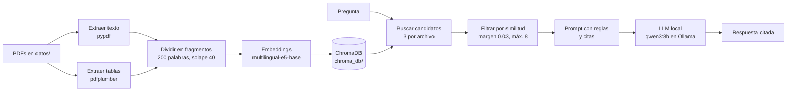

# NeuroClerk

Todo corre en local: los embeddings con `sentence-transformers`, la base vectorial con ChromaDB y el modelo de lenguaje con Ollama. No hace falta ninguna API de pago.

## Cómo funciona



1. **Cargar:** lee el texto de cada página con `pypdf` y une las palabras cortadas con guion ("dificul- tad" → "dificultad").
2. **Tablas:** `pdfplumber` detecta las tablas y guarda cada una como un fragmento propio, con su título delante.
3. **Dividir:** parte el texto en fragmentos de 200 palabras que se solapan 40, para no cortar una idea a la mitad.
4. **Indexar:** convierte cada fragmento en un vector y lo guarda en ChromaDB. Solo se hace la primera vez, o cuando un PDF es nuevo o cambió.
5. **Recuperar:** busca los 3 fragmentos más parecidos de **cada** archivo y descarta los que quedan muy por debajo del mejor.
6. **Generar:** le pasa esos fragmentos al modelo con instrucciones de responder solo con el contexto y citar cada afirmación.

## Estructura del proyecto

```text
NeuroClerk/
├── .venv/                 # entorno virtual (no se sube a Git)
├── datos/                 # tus PDFs (no se suben a Git)
├── chroma_db/             # vectores guardados (no se sube a Git)
├── rag.py                 # el programa completo
├── requirements.txt       # librerías principales
├── requirements-lock.txt  # versiones exactas de todo el entorno
├── .gitignore
└── README.md
```

## Requisitos

- Windows 10/11 (también funciona en macOS y Linux cambiando los comandos de activación).
- **Python 3.12.** Las versiones más nuevas pueden no tener todavía PyTorch disponible.
- [Ollama](https://ollama.com) instalado y abierto.
- Unos 16 GB de RAM para `qwen3:8b`. Con 8 GB, usa `gemma3:4b`.
- VS Code con la extensión Python (opcional, pero recomendado).

## Instalación

```powershell
# 1. Crear y activar el entorno virtual con Python 3.12
py -3.12 -m venv .venv
.venv\Scripts\activate

# 2. Instalar PyTorch (versión CPU) y el resto de librerías
python -m pip install --upgrade pip setuptools wheel
pip install torch --index-url https://download.pytorch.org/whl/cpu
pip install -r requirements.txt

# 3. Descargar el modelo de lenguaje
ollama pull qwen3:8b
```

La primera vez, comenta la línea `os.environ["HF_HUB_OFFLINE"] = "1"` al principio de `rag.py` para que pueda descargar el modelo de embeddings. Después puedes volver a activarla.

En VS Code: `Ctrl+Shift+P` → **Python: Select Interpreter** → el que dice `.venv`.

## Uso

1. Copia tus PDFs en la carpeta `datos/` con nombres claros (`FT_Litio.pdf`, no `FT_63845.pdf`), porque el modelo cita el nombre del archivo.
2. Ejecuta:

   ```powershell
   python .\rag.py
   ```

3. Escribe tus preguntas. Para terminar, escribe `salir`.

La primera ejecución tarda varios minutos porque indexa todo. Las siguientes arrancan en segundos.

Para cada pregunta, el programa muestra los fragmentos usados con su puntaje de similitud, y después la respuesta:

```text
Fragmentos usados:
  -> [0.909] InteraccionesFarmacoloigicas_pr.pdf, página 9: Tabla 1. Fármacos que pueden causar...
  -> [0.894] InteraccionesFarmacoloigicas_pr.pdf, página 9: de receptores), en los procesos...

Respuesta:
...
```

## Configuración

Todo se ajusta en el bloque 0 de `rag.py`:

| Variable | Valor actual | Para qué sirve |
| --- | --- | --- |
| `MODELO_LLM` | `qwen3:8b` | Modelo de Ollama que redacta la respuesta |
| `MODELO_EMBEDDINGS` | `intfloat/multilingual-e5-base` | Modelo que convierte texto en vectores |
| `TAM_CHUNK` | `200` | Palabras por fragmento |
| `SOLAPE` | `40` | Palabras repetidas entre fragmentos seguidos |
| `K_POR_ARCHIVO` | `3` | Candidatos que se buscan en cada PDF |
| `MARGEN` | `0.03` | Se descartan los fragmentos que quedan más de esto por debajo del mejor |
| `MAX_FRAGMENTOS` | `8` | Tope de fragmentos que llegan al modelo |
| `VERSION_TEXTO` | `3` | Súbela cada vez que cambies cómo se extrae o se divide el texto |

Si cambias `MODELO_EMBEDDINGS`, `TAM_CHUNK`, `SOLAPE` o `VERSION_TEXTO`, el programa crea una colección nueva y vuelve a indexar todo automáticamente. Para empezar de cero, borra la carpeta `chroma_db/`.

## Documentos de prueba

| Archivo | Contenido | Páginas |
| --- | --- | --- |
| `dsm5.pdf` | DSM-5, criterios diagnósticos (escaneado con OCR) | 1000 |
| `InteraccionesFarmacoloigicas_pr.pdf` | Introducción a las interacciones farmacológicas (SEFH) | 367 |
| `FT_Sertralina.pdf`, `FT_Litio.pdf`, `FT_Quetiapina.pdf`, `FT_Clozapina.pdf` | Fichas técnicas de la AEMPS ([CIMA](https://cima.aemps.es)) | 15–28 c/u |

Los PDFs no se suben al repositorio por su tamaño y por derechos de autor.

## Problemas encontrados y cómo se resolvieron

### Problemas de instalación

| Problema | Causa | Solución |
| --- | --- | --- |
| "La ejecución de scripts está deshabilitada" | PowerShell bloquea `activate` | `Set-ExecutionPolicy -Scope CurrentUser RemoteSigned` |
| Muchos errores de dependencias | PyTorch todavía no estaba disponible para la versión más nueva de Python | Usar Python 3.12 e instalar PyTorch CPU primero |
| `No suitable Python runtime found` | Python 3.12 no estaba instalado | Instalarlo; puede convivir con otras versiones |
| `cryptography>=3.1 is required for AES` | El PDF de interacciones está cifrado | `pip install cryptography` |
| `NameError: name 'paso' is not defined` | Se borró una línea al editar | Usar el archivo completo en lugar de pegar trozos |
| `model 'qwen3:4b' not found` | El modelo no estaba descargado | `ollama pull <modelo>`; verificar con `ollama list` |
| Aviso "unauthenticated requests to the HF Hub" | Se consultaba Hugging Face en cada arranque | `HF_HUB_OFFLINE=1` con el modelo ya descargado |

### Calidad de la búsqueda

| Problema | Causa | Solución |
| --- | --- | --- |
| El DSM-5 acaparaba todos los resultados | Es casi tres veces más grande que el resto | Traer candidatos de cada archivo por separado |
| Se ignoraba el final de cada fragmento | `MiniLM-L12` lee solo ~128 tokens (~80 palabras) | Cambiar a `multilingual-e5-base` (~300 palabras), con los prefijos `passage:` y `query:` |
| Fragmentos sin relación con la pregunta | Siempre se traía la misma cantidad de cada archivo | Filtro por margen de similitud respecto al mejor |
| Nombrar la fuente en la pregunta empeoraba la búsqueda | "según el DSM-5" atraía páginas que repiten "DSM-5" | Preguntar sin nombrar las fuentes |
| Palabras cortadas ("tem- poral") | OCR del DSM-5 | Expresión regular que une las palabras al cargar |
| Las tablas nunca se encontraban | pypdf las aplana en una lista de nombres sin título, partida en varios fragmentos | Extraerlas con `pdfplumber` como fragmentos propios con el título delante |

### Calidad de la respuesta

| Problema | Causa | Solución |
| --- | --- | --- |
| `llama3.2` fallaba la mayoría de las preguntas | Modelo de 3B, débil en español | Cambiar a `qwen3:8b` |
| Respuestas lentas con texto en inglés antes de `</think>` | `qwen3:4b` es la variante que siempre razona | Usar `qwen3:8b` con `think=False` y recortar lo anterior a `</think>` |
| Datos inventados o mezclados (por ejemplo, "hiperkinesia") | Prompt poco estricto y temperatura por defecto | Reglas explícitas, cita después de cada afirmación y `temperature=0.1` |
| Usaba una sola fuente aunque recibía varias | El modelo copiaba el fragmento más fácil | Regla "si varios fragmentos aportan datos distintos, inclúyelos todos" |
| Recalcular los embeddings en cada ejecución | Los vectores vivían solo en memoria | ChromaDB guardado en disco |

## Resultados de las pruebas

Pregunta de referencia: *"¿Qué es el síndrome neuroléptico maligno, cuáles son sus síntomas y qué fármacos pueden causarlo?"*

| Etapa | Búsqueda | Respuesta |
| --- | --- | --- |
| `llama3.2` + MiniLM | No encontraba la descripción del DSM-5 | La mayoría de las preguntas, mal |
| `qwen3:8b` + e5 | Encontraba DSM-5 págs. 759–760 | 5 errores (síntomas invertidos, fármacos mal clasificados) |
| + prompt con citas y temperatura baja | Igual | 1 error (mezclaba dos síndromes) |
| + filtro por similitud | 6–7 fragmentos, todos relevantes | Sin errores, pero sin usar el DSM-5 |
| + regla "inclúyelos todos" | Igual | Combina 3 fuentes; 1 cita con la página equivocada |
| + tablas con pdfplumber | La Tabla 1 aparece primera (0.909) | Pendiente de probar |

## Limitaciones conocidas

- **Modelo chico:** un modelo de 8B a veces mezcla conceptos parecidos o cita la página equivocada. Siempre hay que revisar las fuentes.
- **PDFs escaneados sin texto:** si `extract_text()` devuelve vacío, hace falta OCR, que todavía no está implementado.
- **Números de página:** son los del PDF, no los impresos en el libro.
- **Preguntas comparativas** ("¿cuáles de estos cuatro fármacos...?") son difíciles para un RAG simple, porque la búsqueda trae fragmentos parecidos a la pregunta y no necesariamente el dato de cada documento.
- **No es una herramienta clínica:** es un proyecto de aprendizaje. Sus respuestas no reemplazan la consulta de las fuentes originales ni el criterio profesional.

## Próximos pasos

- [ ] Probar la versión con tablas en todas las preguntas de referencia.
- [ ] OCR para imágenes y PDFs escaneados (`pytesseract`).
- [ ] Una interfaz web en lugar de la terminal (por ejemplo, Streamlit o Gradio).
- [ ] Un conjunto de preguntas con respuestas conocidas para medir la calidad automáticamente.
